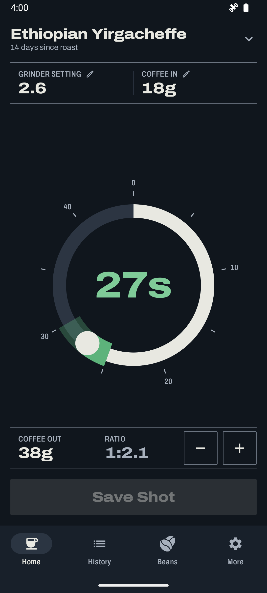
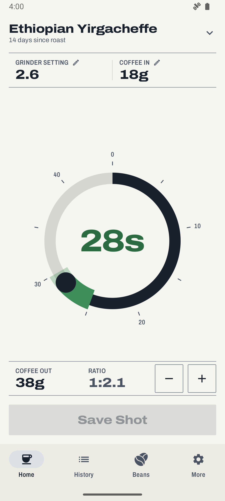
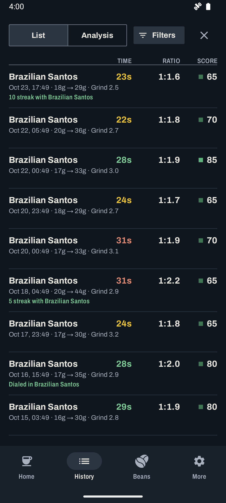
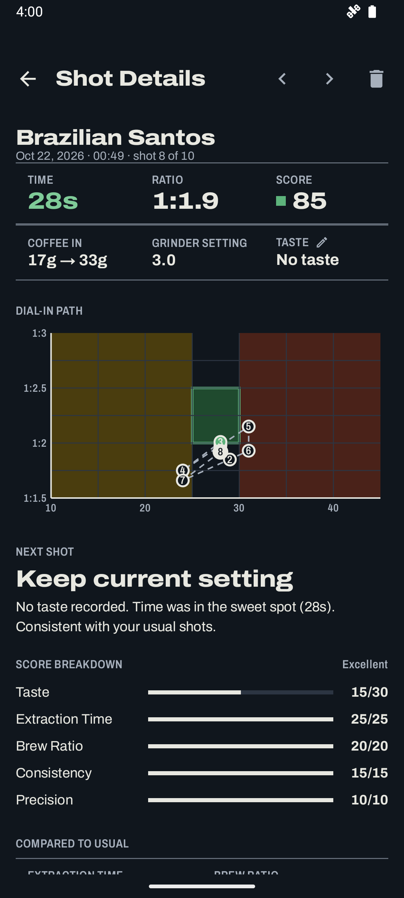
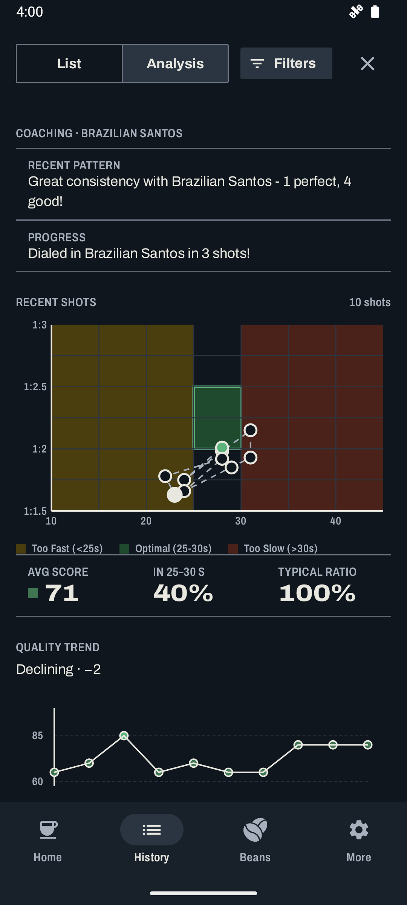
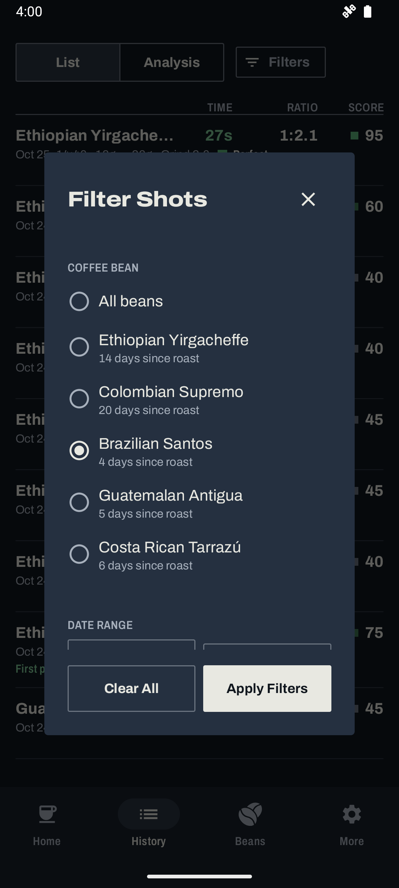
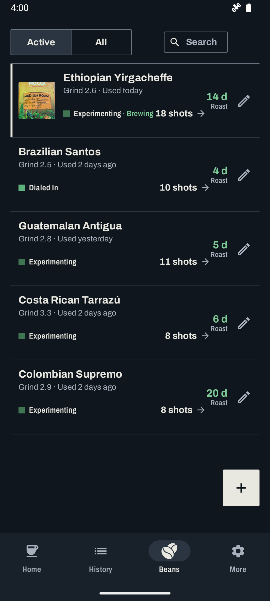
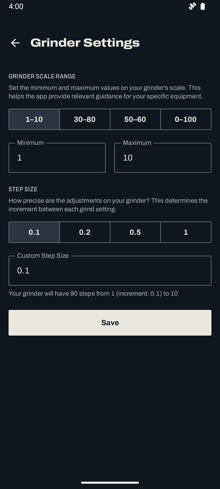
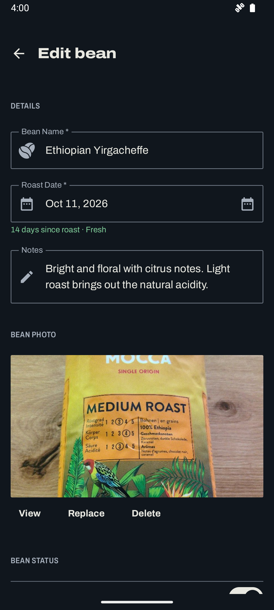

# Coffee Shot Timer

<p align="center">
  
</p>

<p align="center">
  <strong>Espresso timer with analytics for home baristas</strong>
</p>

## Overview

Coffee Shot Timer is a precision Android app designed specifically for espresso machine enthusiasts who want to systematically improve their brewing skills. The app combines intelligent timing with detailed data capture to help you achieve consistent, dialed-in espresso extractions.

## Features

- Shot timer dial with the 25–30 s target always visible, plus a manual mode
- Grinder setting, dose and yield on one screen, with the brew ratio calculated as you go
- Taste feedback (sour, perfect, bitter) and a next-shot grind suggestion in steps of your grinder, saved per bean
- History as a ledger, one line per shot, filterable by bean and date
- Analysis on a time-by-ratio shot chart, with a score out of 100, coaching notes and the quality trend
- Bean management with colour-coded roast age (fresh 4–21 days), dial-in status and package photos
- Grinder range, step size and basket size configurable; works fully offline

## Screenshots

<p align="center">
  
  
  
  
</p>

<p align="center">
  
  
  
  
  
</p>

## Perfect For

- ☕ Espresso machine or manual espresso maker owners
- 🎯 Coffee enthusiasts wanting reproducible results
- 📚 Systematic learners who like data-driven improvement
- 🔧 Baristas looking to refine their technique
- 🏠 Home coffee enthusiasts serious about quality

## ☕ Support the Project

Love Coffee Shot Timer? Consider supporting its development!

[](https://buymeacoffee.com/jodli)

Every coffee fuels late-night coding sessions and exciting new features like pressure profiling and advanced analytics!

## Technology Stack

This is an Android application built with:

- **Kotlin** — primary programming language
- **Android Gradle Plugin** — build system
- **Hilt** — dependency injection
- **Room Database** — local data storage
- **Detekt** — static code analysis

## Getting Started

### Prerequisites

- Android Studio
- Android SDK
- Gradle

### Building the Project

1. Clone the repository:

```bash
git clone https://github.com/jodli/CoffeeShotTimer.git
cd CoffeeShotTimer
```

2. Open the project in Android Studio.

3. Build the project:

```bash
./gradlew build
```

4. Run on a device or emulator:

```bash
./gradlew installDevDebug
```

### Code Quality & Static Analysis

The project uses **Detekt** for static code analysis to maintain code quality:

#### Running Detekt

```bash
# Run detekt analysis with Java 21
JAVA_HOME=/usr/lib/jvm/java-21-openjdk ./gradlew detekt

# Or with default Java (requires Java 21+)
./gradlew detekt
```

#### Detekt Reports

Detekt generates multiple report formats:

- **HTML Report**: `app/build/reports/detekt/detekt.html` - Human-readable report for local development
- **XML Report**: `app/build/reports/detekt/detekt.xml` - For CI/CD integration
- **SARIF Report**: `app/build/reports/detekt/detekt.sarif` - GitHub Security integration

#### Baseline Management

The project uses a baseline file to track existing issues and prevent regressions:

```bash
# Update the baseline (suppresses existing issues)
./gradlew detektBaseline
```

**Note**: Only regenerate the baseline when necessary, as it suppresses existing issues. New code should meet quality standards without baseline suppression.

### Release Build

The project includes configuration for release builds. A pre-built release is available in `app/release/app-release.aab`.

## Project Structure

```
app/src/main/           # Main application source code
app/src/test/           # Unit tests
app/src/androidTest/    # Instrumentation tests
docs/                   # Documentation and screenshots
gradle/                 # Gradle configuration
```

## Development Workflow

This project uses an automated CI/CD pipeline with three deployment tracks and integrated code quality checks:

### 🛠️ Code Quality Pipeline

Every pull request and push triggers:

1. **Build & Test**: Compilation and unit tests
2. **Android Lint**: Built-in Android code analysis
3. **Detekt Analysis**: Kotlin static code analysis with SARIF upload to GitHub Security

Code quality reports are available as:

- GitHub Actions artifacts (HTML reports)
- GitHub Security tab (vulnerabilities and code quality issues)
- PR checks (blocking on failure)

### 🎯 Deployment Tracks

| Trigger                      | Track               | Audience          | Purpose            |
| ---------------------------- | ------------------- | ----------------- | ------------------ |
| Manual dispatch (any branch) | Internal            | Development team  | Test risky changes |
| Push to `main` (app changes) | Beta (Open Testing) | Public beta users | Public testing     |
| Version tag (`v*`)           | Production          | All users         | Live releases      |

## Contributing

Contributions are welcome! Please follow the development workflow above. For major changes, please open an issue first to discuss what you would like to change.

## License

This project is licensed under the terms found in the [LICENSE](LICENSE) file.

## Philosophy

Coffee Shot Timer transforms espresso making from guesswork into precise craftsmanship—without any stress. The app supports you in achieving consistent espresso quality and developing your personal taste preferences through a structured, data-driven approach.

---

<p align="center">
  Made with ☕ for the home barista community
</p>
