# Store entry for de-DE
## App-Name
Coffee Shot Timer

## Kurzbeschreibung
Espresso-Timer und Shot-Log, der dir sagt, wie du den Mahlgrad anpasst

## Vollständige Beschreibung

Stell deinen Espresso Shot für Shot ein, jeder Shot sichtbar am 25–30-Sekunden-Ziel.

Coffee Shot Timer ist ein Shot-Log für Heim-Baristas. Du stoppst den Shot, bewertest den Geschmack, und die App sagt dir, in welche Richtung du die Mühle für den nächsten Shot drehst. Jeder Shot gehört zu seiner Bohne: Öffnest du die Packung wieder, warten der letzte Mahlgrad und der Vorschlag schon auf dich.

Timer
- Ein Zifferblatt mit dem 25–30-s-Zielbereich, immer sichtbar, damit du siehst, wie der Shot darin landet
- Manueller Modus, wenn du die Zeit selbst gemessen hast
- Mahlgrad, Pulver rein und Kaffee raus auf einem Bildschirm, das Verhältnis wird mitgerechnet

Nach dem Shot
- Bewerte ihn als sauer, perfekt oder bitter, optional schwach oder stark
- Ein Mahlgrad-Vorschlag in Schritten deiner eigenen Mühle („3 Schritte feiner → 3.5"), pro Bohne gespeichert
- Punkte von 0 bis 100, aufgeschlüsselt nach Geschmack, Zeit, Verhältnis, Konstanz und Präzision

Verlauf und Analyse
- Eine Zeile pro Shot: Zeit nach Zone eingefärbt, Verhältnis, Mahlgrad und Punkte
- Filter auf eine Bohne oder einen Zeitraum
- Die letzten Shots im Zeit-Verhältnis-Diagramm, mit dem Einstellweg jeder Bohne
- Coaching-Hinweise und der Qualitätsverlauf deiner letzten Shots

Bohnen
- Röstalter als farbige Zahl: ruhend, frisch (4–21 Tage) oder über dem Höhepunkt
- Einstellstatus pro Bohne: neu, Experimentieren, Verbesserungsbedarf oder eingestellt
- Ein Foto der Packung, damit du sie beim Nachkaufen wiedererkennst

Deine Ausrüstung
- Skalenbereich und Schrittweite deiner Mühle, damit die Vorschläge zu den Zahlen auf deiner Skala passen
- Einfaches oder doppeltes Sieb, mit passenden Bereichen für Pulver und Ausbeute

Privat und offline
Die App hat keine Internetberechtigung. Shots, Bohnen und Fotos bleiben auf deinem Handy.

Heller und dunkler Modus, auf Deutsch und Englisch.

## App icon
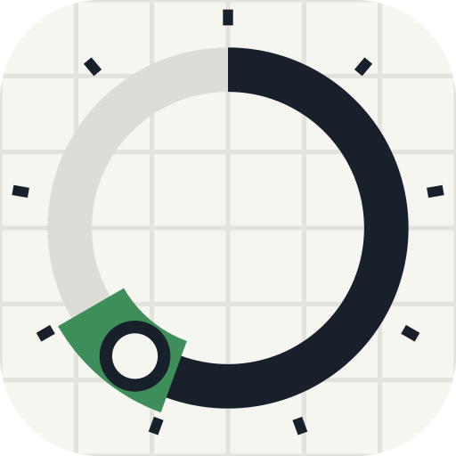

## App banner
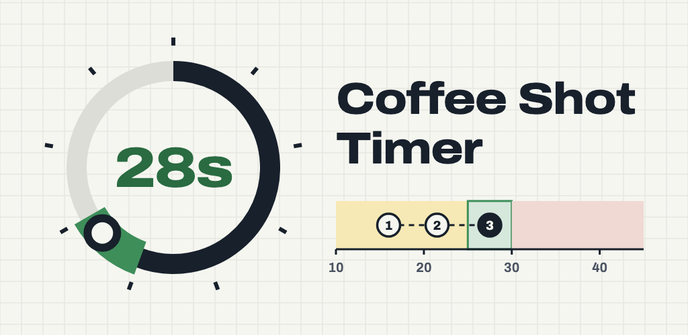

## Screenshots
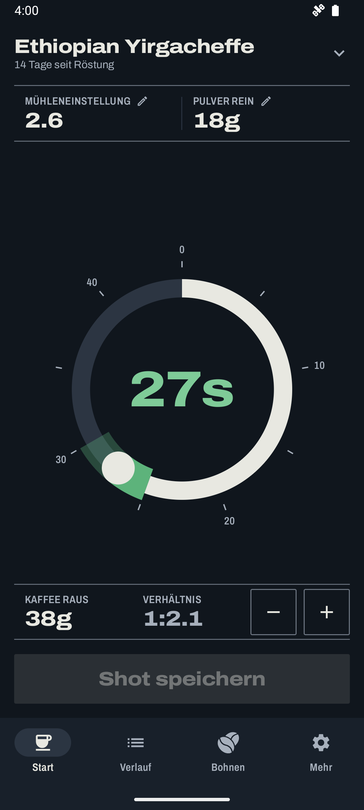
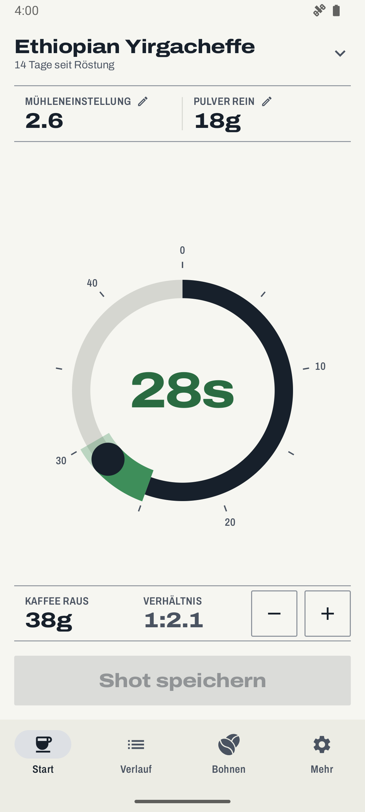
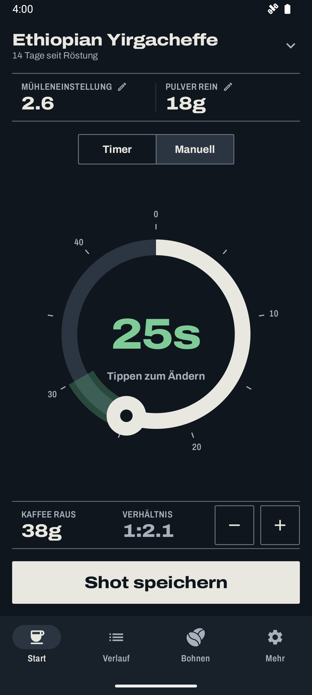
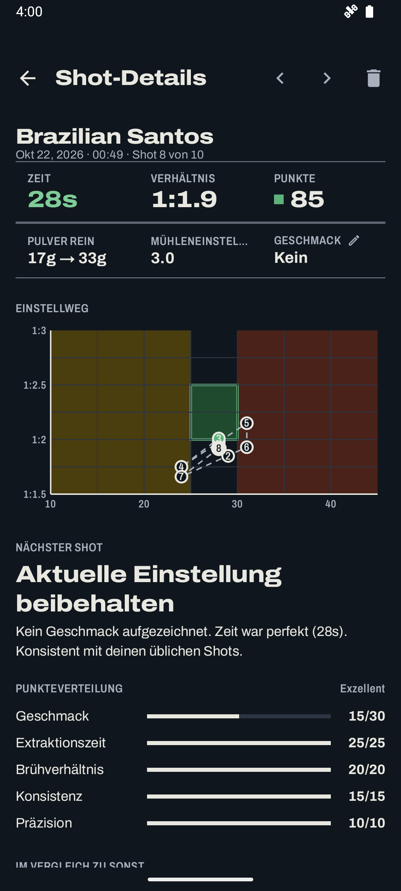
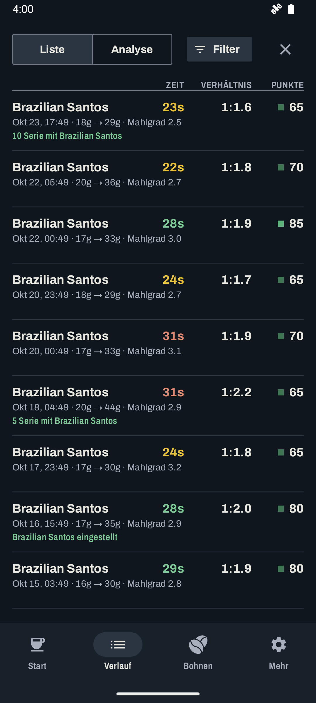
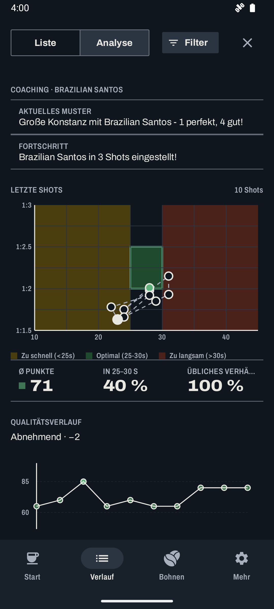
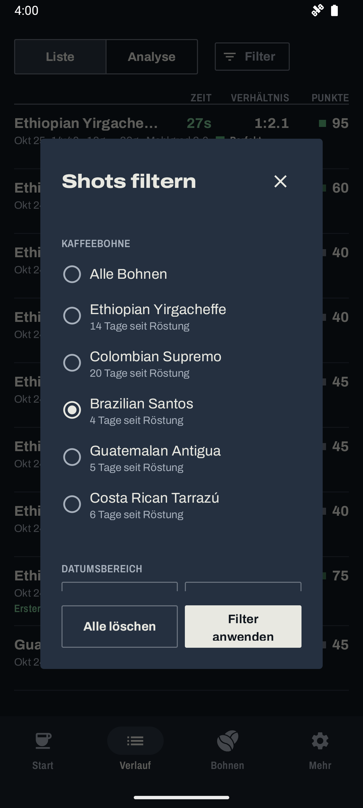
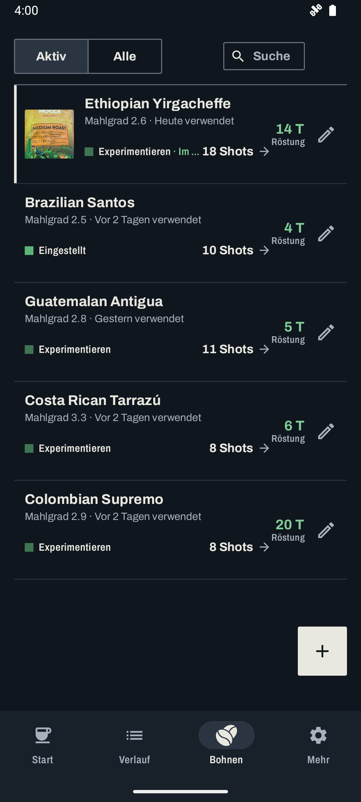
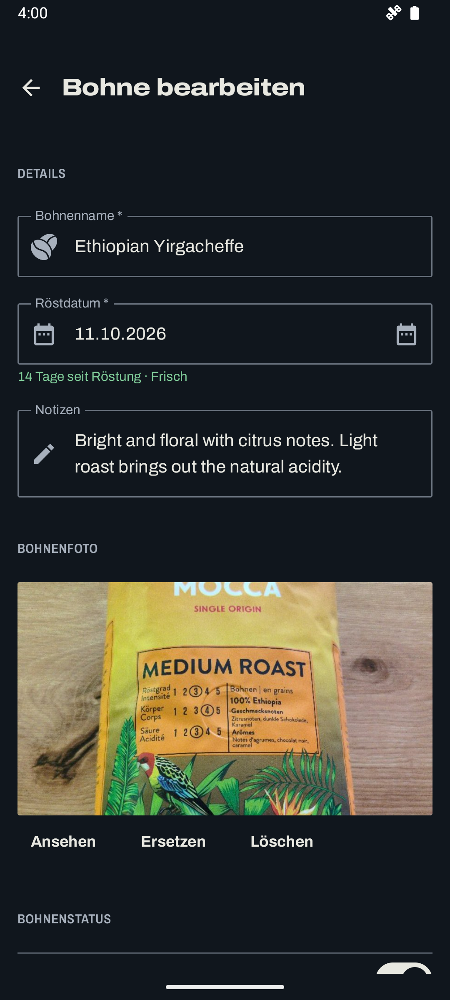
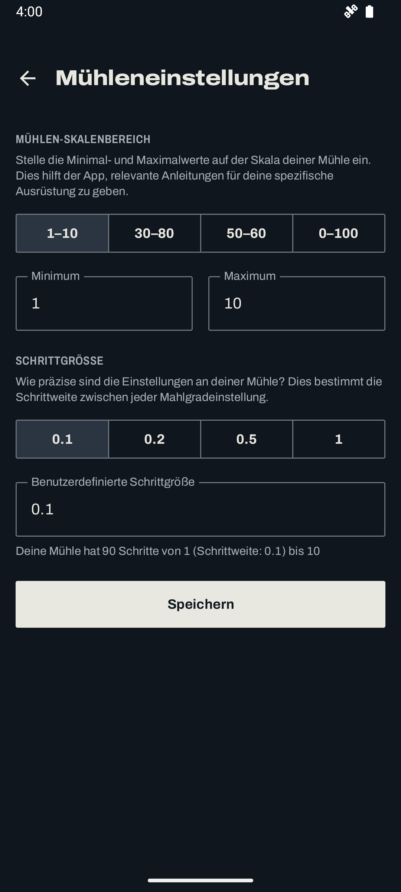