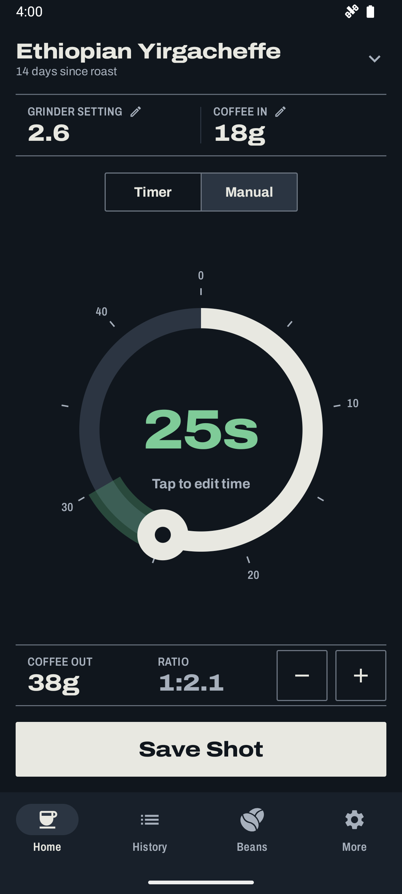

# Store entry for en-US
## App-Name
Coffee Shot Timer

## Short description
Espresso timer that tells you whether to grind finer or coarser next

## Full description

Coffee Shot Timer is an espresso timer and shot log for dialing in at home.

You start the timer when you start the shot. The dial marks 25 to 30 seconds, so you can see where the shot will land while it is still running. If you timed it on the machine instead, type the time in.

Afterwards you note how it tasted (sour, perfect or bitter), and the app works out the next grind setting in your grinder's own steps, for example "3 steps finer → 3.5". The suggestion is saved with the bean, so it is still there the next time you open that bag.

Each shot gets a score out of 100 for taste, time, ratio and consistency. History lists one shot per line and can be filtered by bean or date. The analysis view plots your recent shots by time and ratio, which shows how close a bean is to the target box.

For every bean you keep the roast date, notes and a photo of the bag. The roast age changes colour as the bean rests until day 4, stays fresh up to day 21 and then goes past its peak.

You set up your grinder's scale once, for example 1 to 10 in steps of 0.1, and pick a single or double basket.

The app has no internet permission, so your shots and photos stay on your phone. It comes in English and German, with a light and a dark theme.

## App icon

## App banner

## Screenshots

